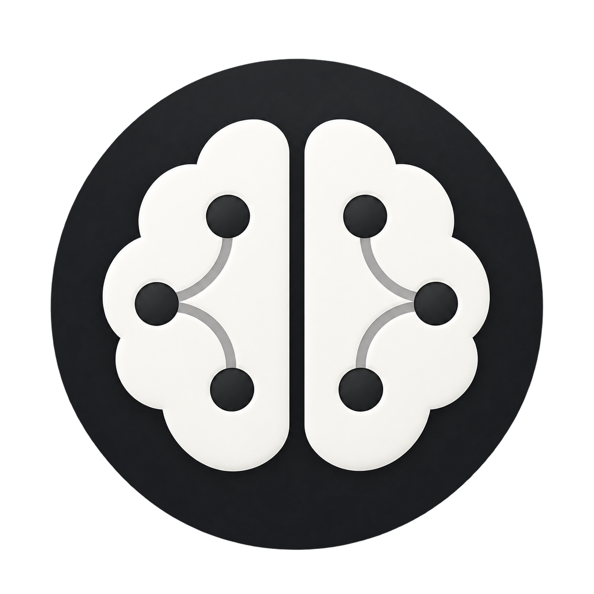
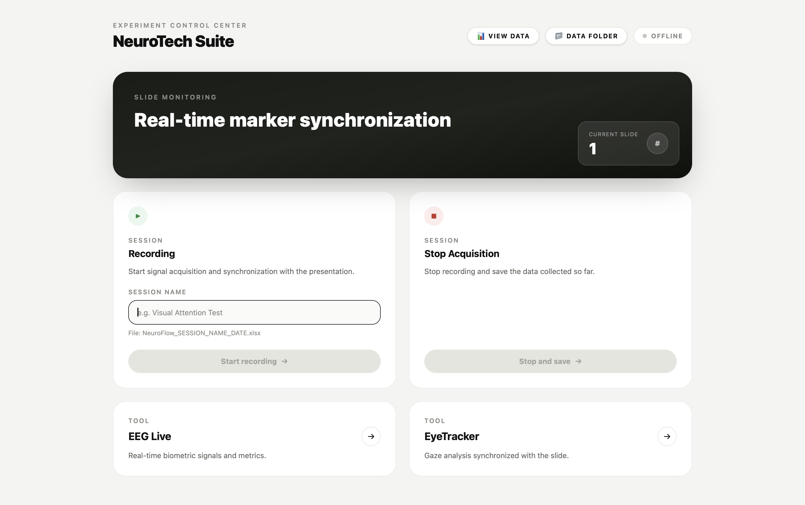

<a id="top"></a>

# NeuroFlow



### Multimodal EEG & Eye-Tracking Research Platform

Experiment control, acquisition and interactive session analysis.

<p>
  
  
  
</p>

A cross-platform research environment for synchronized EEG, eye-tracking and interactive multimodal data analysis.

<br clear="right">

## Overview

NeuroFlow combines EMOTIV EPOC X data, experiment markers and an EyeTracker
interface. The main application workflow works on **Windows and macOS**:
Tauri startup, Python backend, EMOTIV server, recording controls, Excel export
and process cleanup. Real Tobii acquisition remains **Windows-only** in the
current implementation; the PyQt6 interface can also open on macOS.

There are two separate data views:

- **Control Center:** React + Tauri desktop application for session control
  and Excel analysis, including Performance Metrics, BandPower, 2D/3D scalp
  maps and head movement.
- **Live dashboard:** `emotiv/cortex-example/python/charts.html`, served at
  `http://localhost:8080/charts.html` during acquisition.

EyeTracker provides image-stimulus presentation, gaze CSV export, gaze paths,
heatmaps and aggregation of existing gaze recordings.

This is a research prototype, not a medical or diagnostic application.
See [Current data-processing limitations](#current-data-processing-limitations)
before interpreting exported measurements.

<p align="center">
  
</p>

## Contents

- [Architecture and ports](#architecture-and-ports)
- [Project structure](#project-structure)
- [Requirements and platform differences](#requirements-and-platform-differences)
- [Installation](#installation)
- [Running NeuroFlow](#running-neuroflow)
- [EyeTracker and Tobii](#eyetracker-and-tobii)
- [Session files and markers](#session-files-and-markers)
- [Updating an existing checkout](#updating-an-existing-checkout)
- [Verification](#verification)
- [Troubleshooting](#troubleshooting)
- [Current data-processing limitations](#current-data-processing-limitations)
- [Third-party components and licensing](#third-party-components-and-licensing)

## Architecture and ports

```text
Control Center (React + Tauri)
  └─ root .venv: backend.py — JSON commands on stdin, events on stdout
       ├─ Emotiv .venv: emotiv/cortex-example/python/server.py
       │    ├─ local WebSocket: localhost:8765
       │    └─ Cortex client → wss://localhost:6868
       ├─ Emotiv .venv: python -m http.server 8080
       │    └─ charts.html → ws://localhost:8765
       └─ EyeTracker .venv: EyeTracker/Main/avvio.py
            ├─ WebSocket client → localhost:8765
            └─ Windows only: StreamEngine.exe → Tobii Eye Tracker 5
```

| Port | Service | When it is used |
|---|---|---|
| `1420` | Vite frontend | Tauri development; the port is fixed with `strictPort` |
| `1421` | Vite HMR | Configured when `TAURI_DEV_HOST` is set |
| `6868` | EMOTIV Cortex, secure WebSocket | External local service required for headset data |
| `8765` | NeuroFlow EEG WebSocket | Started by the backend when recording begins |
| `8080` | Python HTTP server | Serves the live dashboard during recording |

The backend waits for the `8765` WebSocket before reporting an active session.
This confirms that the local server is ready, **not** that Cortex has already
authorized the application or delivered headset samples.

## Project structure

The following are tracked source files and directories. Generated environments,
SDK contents and build outputs are separate.

```text
.
├── README.md
├── .env.example
├── .gitignore
├── backend.py
├── env_utils.py
├── platform_utils.py
├── keyboard_utils.py
├── requirements.txt
├── assets/
│   ├── neuroflow-logo.png
│   └── dashboard-preview.png
├── control-center/
│   ├── package.json
│   ├── package-lock.json
│   ├── vite.config.js
│   ├── src/
│   │   ├── App.jsx
│   │   └── components/
│   ├── public/models/scalp.glb
│   └── src-tauri/
│       ├── Cargo.toml
│       ├── Cargo.lock
│       ├── tauri.conf.json
│       ├── capabilities/default.json
│       └── src/lib.rs
├── emotiv/cortex-example/
│   ├── LICENSE
│   ├── certificates/rootCA.pem
│   └── python/
│       ├── cortex.py
│       ├── server.py
│       ├── charts.html
│       └── requirements.txt
├── EyeTracker/
│   ├── README.md
│   ├── server.py
│   └── Main/
│       ├── avvio.py
│       ├── config.py
│       ├── ui.py
│       ├── services.py
│       ├── recorder.py
│       ├── requirements.txt
│       ├── screens/
│       └── StreamEngine/
│           ├── StreamEngine.slnx
│           └── StreamEngine/
│               ├── StreamEngine.csproj
│               ├── Program.cs
│               └── Models/GazeData.cs
└── tests/
    ├── test_startup.py
    ├── test_save_flow.py
    └── test_excel_export.py
```

The acquisition server launched by `backend.py` is
`emotiv/cortex-example/python/server.py`. The separate `EyeTracker/server.py`
and the other Cortex examples are not launched by the Control Center.

## Requirements and platform differences

Install Git, Python, Node.js/npm and Rust/Cargo, plus the native build tools
needed by Tauri 2 on your operating system. Follow the
[official Tauri prerequisites](https://v2.tauri.app/start/prerequisites/):
for this desktop project, macOS can use Xcode Command Line Tools; Windows needs
Microsoft C++ Build Tools with **Desktop development with C++** and the WebView2
runtime, in addition to the Rust/MSVC toolchain.

- **Python:** the workflow has been verified with **3.9.6 on macOS** and
  **3.9.13 on Windows**, including the pinned Python dependencies below. Use
  Python 3.9 to reproduce the tested setup; newer versions have not all been
  verified with these pinned packages.
- **Node.js:** the checked-in `control-center/package-lock.json` specifies
  `^20.19.0 || >=22.12.0` for Vite and its React plugin. Use a version satisfying
  that constraint.
- **Frontend:** React 19, Vite 8 and Tauri 2, as declared in `package.json`.
- **EEG acquisition:** EMOTIV Launcher/Cortex, an authenticated EMOTIV account,
  application credentials and a connected EPOC X with access to the requested
  `mot`, `met` and `pow` streams.
- **Tobii acquisition only:** Windows, .NET 9 SDK, Tobii Eye Tracker 5,
  its driver/software and the separately obtained Tobii Stream Engine SDK.

| Detail | macOS | Windows |
|---|---|---|
| Python inside each venv | `.venv/bin/python` | `.venv\Scripts\python.exe` |
| Root venv activation | `source .venv/bin/activate` | `.\.venv\Scripts\Activate.ps1` |
| Backend selected by Tauri | Rust startup prepends the root `.venv/bin` directory to `PATH` | Rust startup prepends the root `.venv\Scripts` directory to `PATH` |
| Global Right Arrow markers | `pynput`; OS keyboard permissions may be needed | `pynput` |
| Data folder | `~/Documents/NeuroTech_Data` | Configured Documents folder, including registry-based redirection, then `NeuroTech_Data` |
| File/folder opening | System `open` command | `os.startfile` |
| Process cleanup | `psutil` | `psutil` |
| EyeTracker interface | Available | Available |
| Current Tobii recorder | Explicitly blocked by `recorder.py` | Requires the SDK and built `StreamEngine.exe` |

The platform helpers also contain Linux branches, but this README documents
the validated Windows/macOS workflow rather than claiming Linux validation.
In Windows PowerShell, use `npm.cmd` for the commands below if `npm` resolves to
`npm.ps1` and script execution is disabled.

## Installation

Run the following sections in order. Unless a block changes directory,
commands are executed from the **repository root**. Do not copy a virtualenv
between operating systems or checkouts: recreate it at the expected location.

### 1. Get the source and check the tools

```bash
git clone https://github.com/Lelio-04/neuroflow.git
cd neuroflow
```

If you already have a checkout, open its root directory instead of cloning again.

On macOS:

```bash
python3 --version
node --version
npm --version
rustc --version
cargo --version
```

If the Xcode Command Line Tools are missing:

```bash
xcode-select --install
```

On Windows PowerShell:

```powershell
py --version
node --version
npm --version
rustc --version
cargo --version
```

### 2. Create all three Python environments

Check that the Python selected above is 3.9 before creating the environments.
If another version is the default, use `python3.9` instead of `python3` on macOS
or `py -3.9` instead of `py -3` on Windows in the commands below.
If the Windows `py` command says it cannot find an installed Python, use the
actual Python 3.9 executable installed on that machine in place of `py -3` for
all three `venv` commands. Do not use the Microsoft Store `python` alias as a
substitute for a working interpreter. See the
[Python Windows installation guide](https://docs.python.org/3.9/using/windows.html)
for launcher and command-selection details.

The environments have different jobs and different requirements:

| Environment | Requirements file | Pinned packages |
|---|---|---|
| Root `.venv` | `requirements.txt` | `websocket-client==1.9.0`, `psutil==7.2.2`, `pynput==1.8.2` |
| `emotiv/cortex-example/python/.venv` | `emotiv/cortex-example/python/requirements.txt` | `websocket-client==1.9.0`, `websockets==15.0.1`, `python-dispatch==0.2.3`, `numpy==2.0.2`, `pandas==2.3.3`, `openpyxl==3.1.5` |
| `EyeTracker/Main/.venv` | `EyeTracker/Main/requirements.txt` | `PyQt6==6.10.2`, `matplotlib==3.9.4`, `numpy==2.0.2`, `pandas==2.3.3`, `scipy==1.13.1`, `websocket-client==1.9.0`, `openpyxl==3.1.5` |

Installing only the root requirements does not install the Emotiv or EyeTracker
packages. The backend selects each child interpreter using `get_venv_python()`;
it does not activate the child environments through a shell.

**macOS:**

```bash
python3 -m venv .venv
.venv/bin/python -m pip install --upgrade pip
.venv/bin/python -m pip install -r requirements.txt

python3 -m venv emotiv/cortex-example/python/.venv
emotiv/cortex-example/python/.venv/bin/python -m pip install --upgrade pip
emotiv/cortex-example/python/.venv/bin/python -m pip install -r emotiv/cortex-example/python/requirements.txt

python3 -m venv EyeTracker/Main/.venv
EyeTracker/Main/.venv/bin/python -m pip install --upgrade pip
EyeTracker/Main/.venv/bin/python -m pip install -r EyeTracker/Main/requirements.txt
```

**Windows PowerShell:**

```powershell
py -3 -m venv .venv
.\.venv\Scripts\python.exe -m pip install --upgrade pip
.\.venv\Scripts\python.exe -m pip install -r requirements.txt

py -3 -m venv emotiv\cortex-example\python\.venv
.\emotiv\cortex-example\python\.venv\Scripts\python.exe -m pip install --upgrade pip
.\emotiv\cortex-example\python\.venv\Scripts\python.exe -m pip install -r emotiv\cortex-example\python\requirements.txt

py -3 -m venv EyeTracker\Main\.venv
.\EyeTracker\Main\.venv\Scripts\python.exe -m pip install --upgrade pip
.\EyeTracker\Main\.venv\Scripts\python.exe -m pip install -r EyeTracker\Main\requirements.txt
```

These installation commands use explicit interpreters and do not require
PowerShell activation scripts to run.

### 3. Configure the root `.env` for Emotiv

Create `.env` from the existing template **only if you do not already have one**.

macOS:

```bash
cp -n .env.example .env
```

Windows PowerShell:

```powershell
if (-not (Test-Path .env)) { Copy-Item .env.example .env }
```

Edit the two entries locally, using credentials for your own Cortex application.
The template intentionally contains empty values:

```dotenv
EMOTIV_CLIENT_ID=
EMOTIV_CLIENT_SECRET=
```

`env_utils.py` loads the `.env` beside `backend.py`, independently of the working
directory. Both the backend and the standalone Emotiv server use this loader.
Existing process environment variables take precedence over the file. Restart
the backend after changing credentials so previously loaded values are cleared.

Empty or missing credentials stop recording startup with an explicit error in
the Control Center developer console.
Opening the Control Center alone does not verify the credentials. Cortex must
also be running, signed in and authorized to provide data from the headset.

`.env` is ignored by Git and is not transferred by `git clone` or `git pull`.
Each checkout needs its own local configuration. Do not publish the values in
source files, screenshots or diagnostic output.

### 4. Install the frontend dependencies

From the repository root, on macOS:

```bash
cd control-center
npm ci
cd ..
```

On Windows PowerShell:

```powershell
cd control-center
npm.cmd ci
cd ..
```

`npm ci` uses the committed lockfile and recreates `node_modules`. Cargo builds
the Rust dependencies when Tauri starts. No global Tauri CLI is required: the
project includes `@tauri-apps/cli` and the `tauri` npm script.

## Running NeuroFlow

### Start the desktop application

On macOS, from the repository root:

```bash
source .venv/bin/activate
python -c "import sys; print(sys.executable)"
cd control-center
npm run tauri dev
```

The printed interpreter should belong to the **root** `.venv`. Tauri startup
explicitly prepends the root `.venv/bin` to `PATH` on macOS, including when
opening a locally built `.app` from Finder. Activation is still useful for
manual backend commands in the terminal.

On Windows PowerShell, from the repository root:

```powershell
cd control-center
npm.cmd run tauri dev
```

Windows Tauri startup explicitly selects the root `.venv\Scripts\python.exe`
by adjusting `PATH`. Root venv activation is optional for this launch command;
the environment itself must exist. When running `backend.py` manually, use the
root interpreter explicitly.

`npm run dev` starts only the browser frontend. It does not provide the Tauri
shell/file APIs needed for the complete application. Use `npm run tauri dev`
for recording and desktop session loading.

### Record, save and close

1. Open EMOTIV Launcher/Cortex, sign in and connect the headset.
2. Start NeuroFlow and enter a session name.
3. Select **Start recording**. The backend checks credentials, starts
   `server.py`, waits for WebSocket availability and starts the HTTP server.
4. EyeTracker and the live dashboard open automatically after approximately
   three seconds. Opening EyeTracker does not start a Tobii recording.
5. Use **Right Arrow** to insert slide markers while the session is active.
6. Select **Stop and save**. The backend waits for the EEG server's save result,
   checks that the expected Excel file exists, then terminates its child processes.
7. Use **View Data** in the Control Center to load a saved Excel workbook.

Closing the Control Center requests a cooperative backend shutdown. If a session
is active, it attempts the same save before cleanup. Tauri waits for the backend
and has a forced-kill fallback after 120 seconds. Let normal shutdown finish.

The backend performs cleanup on ports `8080` and `8765` at startup and shutdown,
including listeners it can inspect on those ports. Keep those ports available
for NeuroFlow and avoid running multiple copies at the same time.

### Build scope

From `control-center`:

```bash
npm run build
npm run tauri build
```

The first command builds the web frontend; the second invokes the configured
Tauri build. The current application still resolves `backend.py` from the source
checkout and requires local Python environments. The Tauri configuration does
not bundle Python, the three venvs or the Tobii SDK as a portable runtime.
A successful build is not a self-contained installer for another machine.
Use `npm.cmd` instead of `npm` for these commands in Windows PowerShell when
script execution is disabled.

## EyeTracker and Tobii

### Interface on Windows and macOS

The application entry point is `EyeTracker/Main/avvio.py`. For a standalone UI
check, from the repository root:

macOS:

```bash
EyeTracker/Main/.venv/bin/python EyeTracker/Main/avvio.py
```

Windows PowerShell:

```powershell
.\EyeTracker\Main\.venv\Scripts\python.exe EyeTracker\Main\avvio.py
```

The UI supports choosing an image, naming a gaze session and inspecting gaze
results. Its Emotiv integration uses the existing server on `localhost:8765`;
starting `avvio.py` alone does not start that server.

On macOS, attempting a Tobii recording displays **Eye Tracker non disponibile**:
`recorder.py` deliberately rejects non-Windows platforms before launching the
bridge. This does not prevent the main EEG workflow or viewing existing gaze data.

### Windows acquisition setup

The tracked C# project is
`EyeTracker/Main/StreamEngine/StreamEngine/StreamEngine.csproj`, targeting
`net9.0`. Python expects its Debug executable at:

```text
EyeTracker/Main/StreamEngine/StreamEngine/bin/Debug/net9.0/StreamEngine.exe
```

For real gaze acquisition:

1. Install the .NET 9 SDK and the software/driver for the Tobii Eye Tracker 5.
2. Obtain the Tobii Stream Engine SDK separately under its licensing terms.
   The repository reserves the ignored directory
   `EyeTracker/Main/StreamEngine/StreamEngine/tobii/` for local SDK contents.
3. Make the SDK's `Tobii.StreamEngine` C# bindings available to the project and
   its native `tobii_stream_engine.dll` available at runtime, matching the
   loader path used by those bindings.
4. Build the existing project from the repository root:

```powershell
dotnet build EyeTracker\Main\StreamEngine\StreamEngine\StreamEngine.csproj -c Debug
```

The checked-in `.csproj` is minimal: it has no package reference that downloads
the Tobii SDK and no rule that copies the native DLL into the output directory.
A source clone alone is therefore insufficient to build/run Tobii acquisition.
If `Tobii.StreamEngine` cannot be resolved, finish the SDK integration first;
reinstalling Python requirements cannot supply the C# bindings.

The recorder launches that specific Debug executable and exchanges `Start`,
`Stop` and `Exit` commands over stdin, reading `GAZE` lines from stdout.
Building only a Release executable will not populate the path it expects.
The older `EyeTracker/Main/Guida all_installazione.txt` describes historical
manual setup; the executable path now comes from `recorder.py`, not a line
number to edit in the UI.

## Session files and markers

The backend resolves the user's Documents directory through `platform_utils.py`
and creates `NeuroTech_Data` there. On Windows it respects the configured
Documents registry path, including redirected folders. It passes the resulting
location to its children as `NEUROFLOW_DATA_DIR`.

Standalone Emotiv/EyeTracker processes can read `NEUROFLOW_DATA_DIR` from their
environment; otherwise they fall back to `~/Documents/NeuroTech_Data`. The
normal backend launch computes and sets this value itself.

Control Center exports use:

```text
NeuroFlow_<sanitized_session_name>_<YYYY-MM-DD>.xlsx
```

Names are normalized; duplicates receive `_2`, `_3`, etc. The standalone server's
default export name, when no path is supplied, is `dati_emotiv_<timestamp>.xlsx`.

| Excel sheet | Contents / creation condition |
|---|---|
| `Sessione` | Session name, export date/time, sample counts and marker count |
| `Motion` | `mot` samples, timestamps and markers; requires samples and labels |
| `Performance` | `met` samples, timestamps and markers; requires samples and labels |
| `BandPower` | `pow` samples, timestamps and markers; requires samples and labels |
| `Markers` | `time`, `label`, `samples_at_set`; created when markers exist |

An Excel file with metadata and markers but no stream sheets does not prove that
headset data was acquired. Check Cortex authorization, stream availability and
sample counts.

The Control Center marker sequence is implemented locally in `server.py`:

- Starting the recording does not create a marker. Samples before the first
  slide are preserved in Excel but excluded from analysis.
- `inizio slide1`, `inizio slide2`, etc.: sent on Right Arrow; repeated events
  within 0.50 seconds are ignored by the backend.
- The last Right Arrow enters the final, unmonitored slide. That marker closes
  the last monitored slide; its label and timestamp remain unchanged.
- `stop`: a separate marker records Stop and Save, using the backend's stop
  event timestamp. Repeated save requests do not duplicate it.

Session Analysis includes samples from the first slide marker (inclusive) to
the final slide marker (exclusive). The final-slide-to-stop interval is
excluded from summary averages, scalp maps, head movement and color scales.
Performance Metrics shows the full recording, shading pre-presentation and
final-slide-to-stop intervals gray and identifying excluded samples in its
tooltip. Its time zero is the earliest available recording timestamp (including
the start marker in legacy files); samples after an explicit Stop are not plotted.
The final slide keeps its S-number; END labels Stop and Save. For legacy files
without a Stop marker, END is inferred from the last recorded timestamp and the
chart states this limitation. Display-only holds extend the first/last Performance
sample to 0/END when needed, without moving measured timestamps or affecting
analysis. Synthetic endpoints have no sample dot and are identified in tooltips.
X-axis labels use at most one decimal second; underlying times remain precise.
Other analysis timelines start at the first slide marker; summary duration and
slide count refer to monitored slides only.
The scalp maps and BandPower matrix share fixed scales across monitored slides.
Legacy exports with `start` and a renamed `finish` marker remain supported:
`finish` is treated as the final slide boundary, not as the recording stop.
Files without a bounded monitored slide interval display an empty-analysis
message; any recorded Performance samples remain visible in a fully gray chart.

Keyboard markers carry the Python event's `time.time()` timestamp. These are
NeuroFlow labels stored with buffered samples, not Cortex API `injectMarker`
requests. EyeTracker separately sends `START_<session_name>` and `STOP_TOBII`.

EyeTracker saves `<session_name>.csv` in its data directory with the columns
`X`, `Y`, `Timestamp`, `Timestamp_raw`. Reusing that name overwrites that gaze CSV.
`Timestamp` is the Python receive time in epoch seconds; `Timestamp_raw` comes
from the C# bridge's UTC epoch milliseconds. Reports are saved through the UI's
file-selection dialog.

Session data normally lives outside the repository. `.gitignore` excludes some
session Excel patterns, but not every possible Excel/CSV name: avoid adding
exported data to Git if you copy it into the checkout.

## Updating an existing checkout

Close the application and inspect local changes before updating:

```bash
git status
git pull --ff-only
```

If there are local source changes or Git refuses the fast-forward, preserve and
resolve those changes before continuing. A pull does not create or transfer
`.env`, venvs, `node_modules`, the Tobii SDK or generated binaries.

- Keep each checkout's own `.env` and environments.
- If a Python requirements file changed, rerun the install command for that
  component's interpreter.
- If the frontend manifest/lockfile changed, rerun `npm ci` in `control-center`.
- If the C# bridge changed, rebuild it on Windows with the local SDK configured.

No environment recreation is needed merely because a source-only patch arrived.

## Verification

### Application smoke check

On each target machine, verify the actual workflow:

1. Open the Control Center with `npm run tauri dev`.
2. Enter a session name and start recording. Confirm both `8765` and `8080`
   listeners, and actual incoming Cortex samples in the live dashboard.
3. Confirm that EyeTracker opens. On macOS, expect its Windows-only Tobii
   acquisition message if you try to record gaze.
4. Add a few slide markers, stop and verify the Excel file and sample counts.
5. Load the saved file through **View Data**.
6. Start a second session and close the Control Center directly. Confirm save
   completion and that its children and `8080`/`8765` listeners terminate.

### Existing regression tests

Run the tests in the environments that provide their imports, from the root.

macOS:

```bash
.venv/bin/python -m unittest discover -s tests -p test_startup.py
.venv/bin/python -m unittest discover -s tests -p test_save_flow.py
emotiv/cortex-example/python/.venv/bin/python -m unittest discover -s tests -p test_excel_export.py
```

Windows PowerShell:

```powershell
.\.venv\Scripts\python.exe -m unittest discover -s tests -p test_startup.py
.\.venv\Scripts\python.exe -m unittest discover -s tests -p test_save_flow.py
.\emotiv\cortex-example\python\.venv\Scripts\python.exe -m unittest discover -s tests -p test_excel_export.py
```

These cover configuration/startup errors, save acknowledgements and Excel/marker
export. They mock hardware interaction and do not certify headset/Tobii access.
A Windows/macOS Rust test in `control-center/src-tauri/src/lib.rs` checks the
root Python environment selection. With the root venv installed, run it from
the repository root (on macOS, use `/` as the path separator):

```powershell
cargo test --manifest-path control-center\src-tauri\Cargo.toml
```

## Troubleshooting

### Missing Emotiv credentials / server exits before opening 8765

Check that the **root** `.env` exists and both entries are filled. A fresh clone
will have `.env.example` only. The backend reports missing values before spawning
acquisition processes. The standalone server validates the same configuration.
Existing environment variables override `.env`; restart the app after edits.

### Get the actual Emotiv traceback

Close any existing NeuroFlow recording first. From the repository root, run the
server directly with its own interpreter, keeping stdout/stderr visible:

macOS:

```bash
emotiv/cortex-example/python/.venv/bin/python -u emotiv/cortex-example/python/server.py
```

Windows PowerShell:

```powershell
.\emotiv\cortex-example\python\.venv\Scripts\python.exe -u emotiv\cortex-example\python\server.py
```

Stop the diagnostic process with Ctrl+C before returning to normal app startup.
The Control Center also sends inherited Python stderr to its developer console
as `Python stderr:`. A startup exit code or timeout returns the backend to the
stopped state and cleans up the children it registered.

### Missing packages or Python executable

Use the relevant interpreter from the installation table and reinstall **that
component's** requirements. For example, `numpy`, `pandas`, `websockets` and
`python-dispatch` belong to the Emotiv environment; `psutil` and `pynput` belong
to the root environment. `PyQt6` belongs to EyeTracker.

On macOS, confirm `python -c "import sys; print(sys.executable)"` points to the
root venv before launching Tauri. On Windows, the startup error
`NeuroFlow Python environment is missing` means the root
`.venv\Scripts\python.exe` was not found. Copied/moved venvs can retain invalid
interpreter paths; recreate them in the checkout instead of patching user paths
into source files.

### WebSocket listening but no EEG data

Port `8765` is NeuroFlow's server; `6868` is the separate Cortex service. Check
EMOTIV Launcher, login, application authorization, headset availability and
access to `mot`, `met`, `pow`. Cortex uses the tracked certificate
`emotiv/cortex-example/certificates/rootCA.pem`. A running local WebSocket or
HTTP dashboard alone does not establish that the EEG session is receiving data.

### Inspect ports and leftover processes

macOS:

```bash
lsof -nP -iTCP:8765 -iTCP:8080 -sTCP:LISTEN
ps aux | grep -E 'backend.py|server.py|http.server|avvio.py' | grep -v grep
```

Windows PowerShell:

```powershell
Get-NetTCPConnection -State Listen | Where-Object { $_.LocalPort -in 8080,8765 }
Get-CimInstance Win32_Process | Where-Object { $_.Name -match 'python' } | Select-Object ProcessId,CommandLine
```

Start recording is what creates these acquisition listeners. After a normal stop,
`backend.py` remains available for the next session; after app shutdown it should
exit too. Identify any remaining process before terminating it. Processes the
current user cannot inspect may be skipped by the `psutil` cleanup.

If Vite reports that `1420` is occupied, stop the other development server;
`strictPort` prevents silently switching ports.

### UI opens, but keyboard markers do not advance on macOS

The root backend uses `pynput` for a global Right Arrow listener. Check macOS
Accessibility/Input Monitoring permissions for the terminal/application running
Python, then restart it after permission changes. The recording must be active;
the backend intentionally debounces presses within 0.50 seconds.

### EyeTracker opens but Tobii recording fails

On macOS this is the documented Windows-only acquisition restriction. On Windows,
check the Debug executable path, the .NET runtime, local C# SDK bindings, native
DLL and connected device. Missing `Tobii.StreamEngine` at build time indicates
missing bindings; a missing DLL at runtime requires completing the local SDK
layout. Python package installation cannot fix either issue.

### Save error or workbook contains no EEG sheets

The Control Center no longer displays a save-result banner. Use **Data Folder**
to confirm that the workbook was created. If saving fails, the backend error is
logged in the Control Center developer console as `Python backend error:`.
Confirm the destination is writable and, especially on Windows, that Excel has
not locked the target file. The backend reports success only after a positive
server acknowledgement and a file existence check. Missing stream sheets may
mean no samples or labels arrived. Inspect `Sessione` counts and Cortex status.
See the reconnect limitation below.

### Frontend/native build problems or blank live charts

Check the Node requirement from the lockfile and reinstall frontend dependencies
with `npm ci`. Verify `rustc`/`cargo` and native Tauri build prerequisites if the
Rust build fails. Use the desktop launch command rather than only `npm run dev`.
The live `charts.html` loads JavaScript, styles and fonts from external CDNs;
blocked network access can affect that view even while local services are running.

## Current data-processing limitations

These behaviors are present in the checked-in code:

- `server.py` subscribes to derived `mot`, `met` and `pow` streams, not a raw
  `eeg` stream. Values from these streams are buffered and exported as received
  from Cortex, without artificial noise or five-decimal rounding. The live
  dashboard still formats metrics as percentages and rounds display values.
  Older recordings made with artificial ±15% noise already contain modified
  values; removing noise injection does not recover their original samples.
- The Cortex reconnect loop creates a new `DataCollector`, resetting its buffers
  and markers. A reconnect can lose previously buffered, unsaved session data.
- EyeTracker's `sync_emotiv()` waits for a reply and falls back to a local send
  timestamp. The active server does not send a dedicated marker acknowledgement
  with an `epoch` field. Its save response also does not supply the EyeTracker
  client's optional session start/end fields. Do not assume hardware-level or
  guaranteed sample-accurate synchronization from this exchange.
- The scalp maps interpolate the 14 EPOC X sensor values. They are not cortical
  source localization or subject-specific anatomical reconstruction. Head
  movement indicators identify possible motion contamination, not confirmed EEG
  artifacts.

## Third-party components and licensing

NeuroFlow uses EMOTIV Cortex, Tobii Stream Engine, React, Vite, Tauri, Rust,
Three.js, Recharts, PyQt6, NumPy, pandas, SciPy, Matplotlib and other dependencies
listed in its manifests. Their licenses and access terms remain applicable.

The EMOTIV examples include [their own license](emotiv/cortex-example/LICENSE).
The Tobii SDK and its generated build output are not tracked and must be obtained
and configured separately. No project-wide license file is currently present.

Developed by **Lelio Crisci** as part of an academic thesis project.

<p align="right"><a href="#top">↑ Back to top</a></p>
